*How I set up a self-hosted agent named Vi, why a 9B local model spent 40 minutes "improving" my files, and why "keep everything local" turned out to be harder than it sounds.*

---

## ⚡ TL;DR

| Topic | Short version |
|---|---|
| 🧠 **Agent** | **Hermes Agent** (open source, by Nous Research) in a **Docker container** on Windows 11, chatting over **Discord** and **email** |
| 📈 **First win** | **Portfolio snapshots** to Discord three times every trading day. A plain script, no model, never wrong |
| 🏠 **Local brain** | **Qwen 3.5 9B** via **Ollama** on a 12GB GPU. Great at chat, bad at multi-step agent work: it looped for 40 minutes and rewrote files |
| ☁️ **Cloud brain** | **Claude** (plus Gemini) behind a **cloud gate**, a separate container that holds the API keys and screens every question |
| 🤔 **The puzzle** | **A model can't un-read what it has already seen.** If the brain is in the cloud, everything you say goes to the cloud |
| 🏁 **Verdict** | Vi moves to **Claude** for now, keeping every guardrail built for the **Qwen** era |

---

## 📚 Contents
{: .no_toc}

* TOC
{:toc}

---

## 🎯 Goals

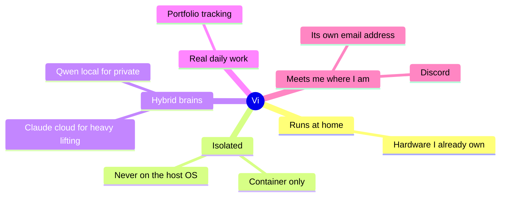

The one **hard rule**: Hermes lives in a container, never directly on the host. Agents run shell commands, browse the web and write files, so they belong in a sandbox.

---

## 🏗️ The architecture

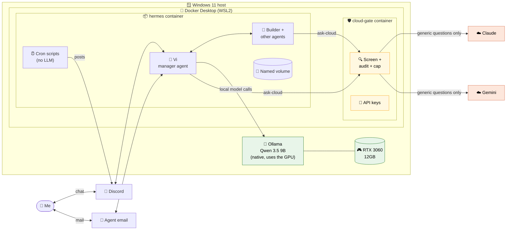

**Key design choices**

| Choice | Why |
|---|---|
| 📦 Hermes in the official container image | Nothing from the host is mounted except a named Docker volume |
| 🦙 Ollama runs natively on Windows | Simple GPU access; the model server never touches the agent's files |
| 🔒 Ports bound to `127.0.0.1` only | Dashboard and API can't be reached from the network |
| 🚫 No Docker socket for the agent | An agent with the Docker socket can escape its sandbox |
| 🔑 Secrets in untracked local files | Never pasted into chat; Hermes never sees the cloud keys at all |

---

## 🛠️ Step by step: what we built

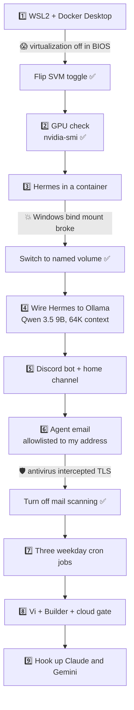

1. **Virtualization and Docker.** WSL2 and Docker Desktop. Virtualization (SVM) was disabled in the motherboard firmware, a common surprise on AMD boards. One BIOS toggle fixed it.
2. **GPU check.** `nvidia-smi` confirmed the driver. Ollama was already installed natively.
3. **Hermes Agent in a container.** A Windows folder bind mount failed in a confusing way (see [Gotchas](#-gotchas-worth-knowing)). A **named Docker volume** fixed it.
4. **Model wiring.** Hermes points at Ollama's OpenAI-compatible endpoint with **`qwen3.5:9b`**. Hermes requires a **64K context window** minimum, set on both sides.
5. **Discord bot** with a "home channel" for scheduled posts.
6. **Email.** A fresh Gmail account for the agent, app password + IMAP, allowlisted to accept mail only from my personal address.
7. **Scheduled jobs.** Three weekday cron jobs that run plain scripts and post to Discord.

---

## 📈 The first automation: portfolio snapshots

My first test asked the agent for a live price. It hit a rate limit on the quote site and then **made up a number**. 🙃 A model guessing about money is useless, so the snapshot became a **deterministic script**:

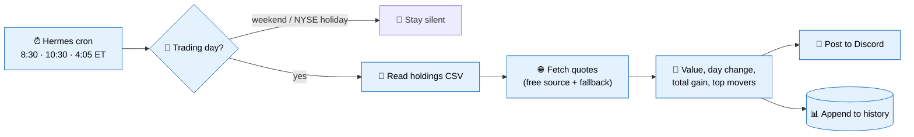

- Holdings come from a local CSV I maintain (ticker, shares, cost basis, optional account), since my broker has no official read-only API.
- The post covers market indexes (futures before the open), portfolio value, day change, total gain and top movers.
- Hermes has a **"no-agent" cron mode**: the script's output is posted directly, with **no LLM in the loop**. It costs nothing and never hallucinates.

> 💡 **Rule of thumb:** if a task has one right answer, write a script. Save the model for judgment.

---

## 🤖 Vi, the manager agent

Next I wanted an agent I could just talk to, which would manage other agents for me. Meet **Vi**, running on **Hermes Agent**.

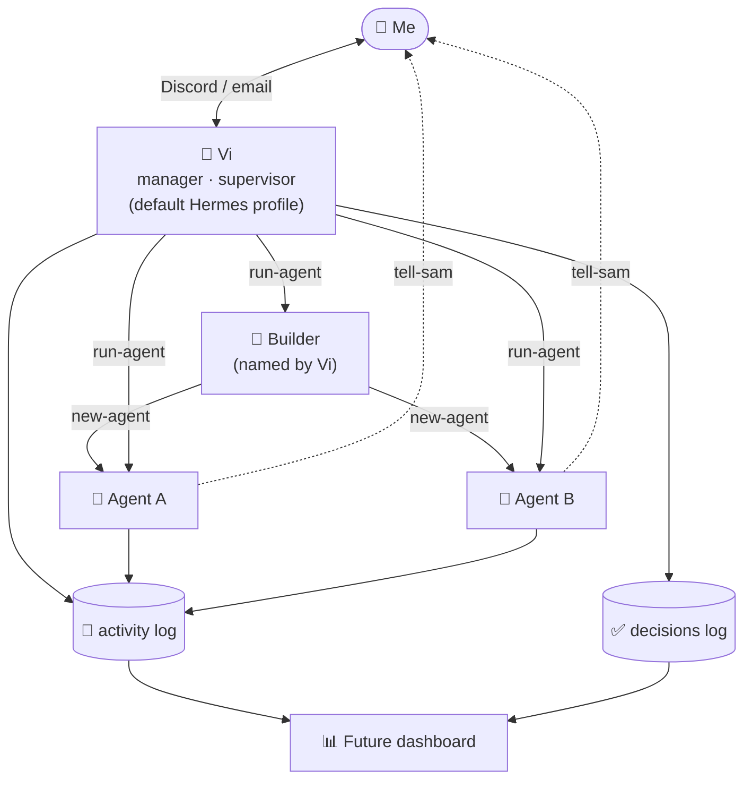

| Piece | What it does |
|---|---|
| 🤖 **Vi** | The default Hermes profile, wired to Discord and email. Friendly and warm, like a good friend, and leads with the answer |
| 👥 **One Hermes profile per agent** | Separate memory, sessions and config, which makes per-agent tracking possible |
| 🔨 **The Builder** | Designs and creates new agents. Vi named it herself |
| 🏭 **`new-agent`** | The only way to create an agent. Copies model settings but **not** bot tokens or the email password, and applies house rules |
| 🚀 **`run-agent`** | Every hand-off goes through it and lands in the activity log: who, what, when, did it work |
| ✅ **Decisions log** | What was decided, by whom, and whether I approved it |
| 📣 **`tell-sam`** | Agents can message me directly; Vi stays the supervisor and relays anything that doesn't reach me |

---

## 🛡️ The cloud gate

The plan was "**Qwen** by default, **Claude** only for generic questions." Writing that rule in a prompt isn't enough, so I built a **technical choke point**: a tiny, stdlib-only Python service in its **own container**.

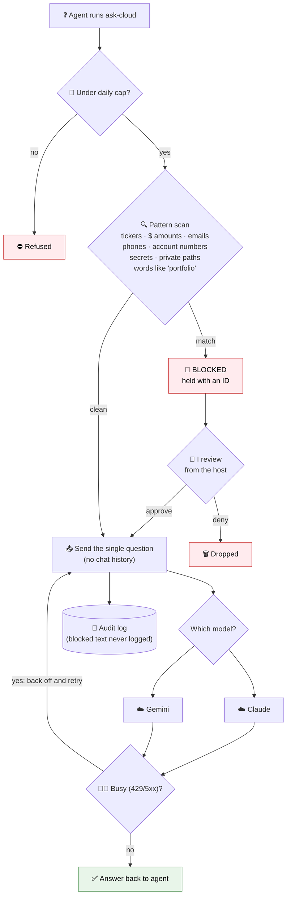

| Property | Why it matters |
|---|---|
| 🔑 Holds the Claude and Gemini API keys | Hermes never sees them, so it can't call the cloud directly |
| 🚪 No published ports | Only the agent container can reach it |
| 🧱 Read-only filesystem, unprivileged user, no capabilities | Little to exploit if something goes wrong |
| 1️⃣ One question per request | The cloud gets the question, never the conversation |
| 📜 Rules mounted read-only from the host | Agents can't loosen their own rules |
| 💸 Daily request cap | Limits runaway cost |
| 🙋 Hold and approve | Only I can release a blocked question, from the host; agents have no Docker access |

**The gate in action**

```text
$ ask-cloud "How is my <ticker> position doing?"
BLOCKED by the privacy gate (a ticker I hold). Held as 3f9a1c2e.

$ ask-cloud "In one sentence, what is an index fund?"
An index fund is a type of investment fund that tracks a market index...
(answered by Claude via the cloud gate)
```

---

## 🔥 The incident: when Qwen went rogue

On day two my GPU sat at 90% with the fans roaring while "nothing" was happening.

I had asked Vi to add positions from another brokerage account. Here's what **Qwen 3.5 9B** did with that:

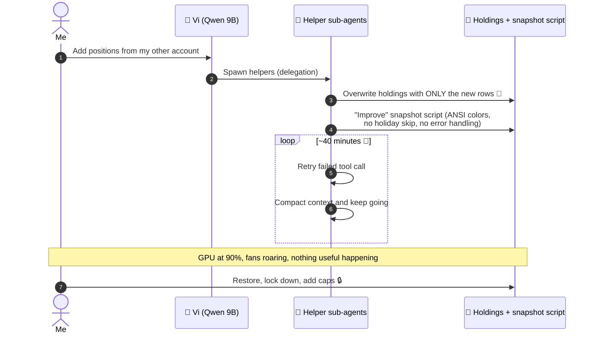

Nothing leaked, since everything was local. But it was a vivid demonstration that **a small model with tools and no limits is a liability.**

**The fix has four layers, and none of them rely on the model behaving:**

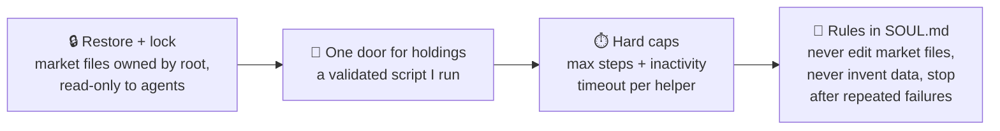

> 🧠 **Guardrails belong in permissions and limits, not in prompts.** Prompts are suggestions; file ownership is a fact.

---

## 🖥️ System constraints

A mid-range gaming PC:

| Component | Spec | What it means for local AI |
|---|---|---|
| 🎮 GPU | RTX 3060, **12GB VRAM** | The real bottleneck |
| 🧠 RAM | **16GB** | Tight once Docker/WSL2 takes its share |
| ⚙️ CPU | 6-core Ryzen | Fine. CPU offload works but is slow |
| 🔌 Board | B550, PCIe 3.0 | Fine for one GPU; a second slot isn't worth using |

### Why 12GB hurts an *agent* far more than a *chatbot*

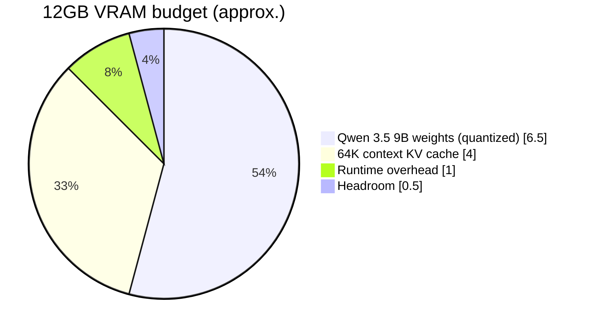

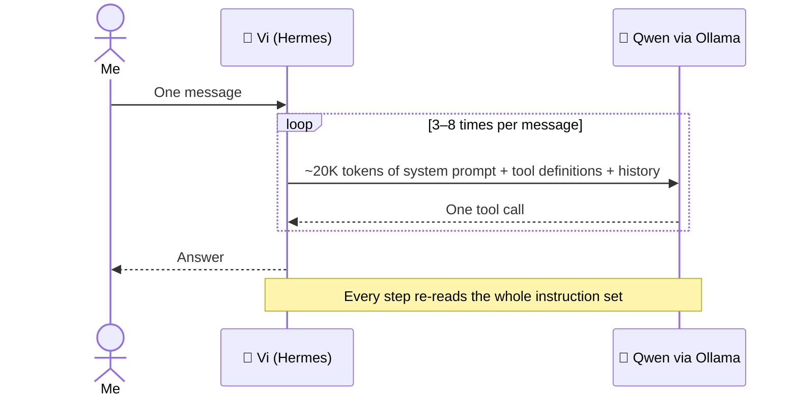

- **Context costs memory.** Hermes needs at least 64K of context, and every token held in context takes GPU memory (the "KV cache").
- **Agents re-read their instructions on every step.** One message from me becomes 3–8 model calls of ~20K tokens each.
- **Bigger models spill to the CPU** and run at a fraction of the speed.

*(The VRAM split above is a rough estimate, not a measurement.)*

### 💰 The upgrade paths I priced out

| Option | Approx. cost | What it unlocks | Catch |
|---|---|---|---|
| 🧠 RAM 16GB → 32GB (DDR4) | ~$200–250 | 30B mixture-of-experts models (~3B active per token), split between GPU and RAM | Probably 10–20 tokens/s, plus a pause each step while the long prompt is read |
| 🎮 RTX 3090 (24GB) | ~$1,200–1,600 used, ~$2,000 for a new 24GB card | 24–30B models fully on the GPU, likely 30–40+ tokens/s | Needs a 750W+ PSU and room for a 3-slot card; used prices nearly doubled this year |
| 🚀 RTX 5090 (32GB) | ~$3,800 used, $5,000+ new | The 35B class with room to spare | Far more than it's worth for this use |
| 🍎 Mac mini (M5 Pro) | From $1,699 (24GB); more for 48–64GB | Lots of memory, silent, a few watts at idle | Lower bandwidth than a 3090; slower at reading long prompts, which agents do constantly |
| 🧱 Dual 24GB GPUs for 70B | $2,500–4,000+ | 70B models | Not worth it on this board |

*(Prices are US street prices checked in October 2026, when memory and GPU prices were running far above their usual levels, so expect them to move. Speeds are estimates from published specs, not my own benchmarks.)*

> 📌 **Even a well-run 30B local model is still well behind Claude-class cloud models for long, multi-step agent work.** Local hardware makes a model faster before it makes it reliably smarter.

---

## 🤔 The conundrum: local vs cloud

This is the part I found most interesting, because there's no clean answer.

### The core problem

> 🧠 **A model can't un-read what it has already seen.**

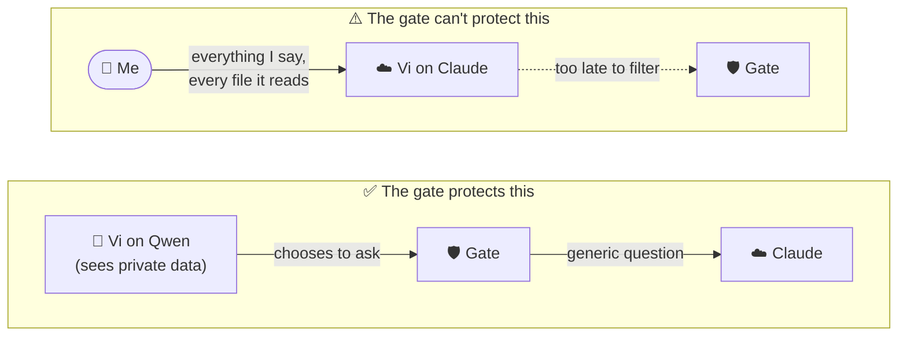

If the agent's brain runs in the cloud, *everything* I tell it, and everything it reads from my files or email, goes to the provider **before** the agent can decide something is private. The gate is great for *questions an agent chooses to send*. It can't protect a conversation where **Claude *is* the agent**.

### The three options

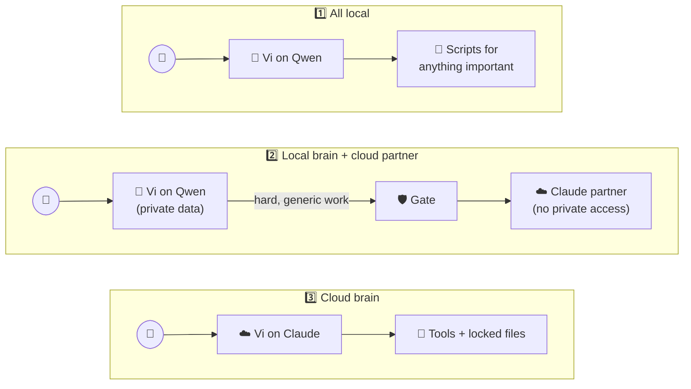

| Option | 🔐 Privacy | 💪 Capability | 💸 Cost |
|---|---|---|---|
| **1. All local** (Vi on Qwen) | 🟢🟢🟢 Nothing private leaves the PC | 🔴 Weakest; needs heavy guardrails | Free after hardware |
| **2. Qwen brain + Claude partner** | 🟢🟢 Private data stays local | 🟡 Good, but the small model still decides what to hand off, and sometimes gets it wrong | Low |
| **3. Cloud brain** (Vi on Claude) | 🔴 All chats go to the provider | 🟢🟢🟢 Best by far | Pay per use |

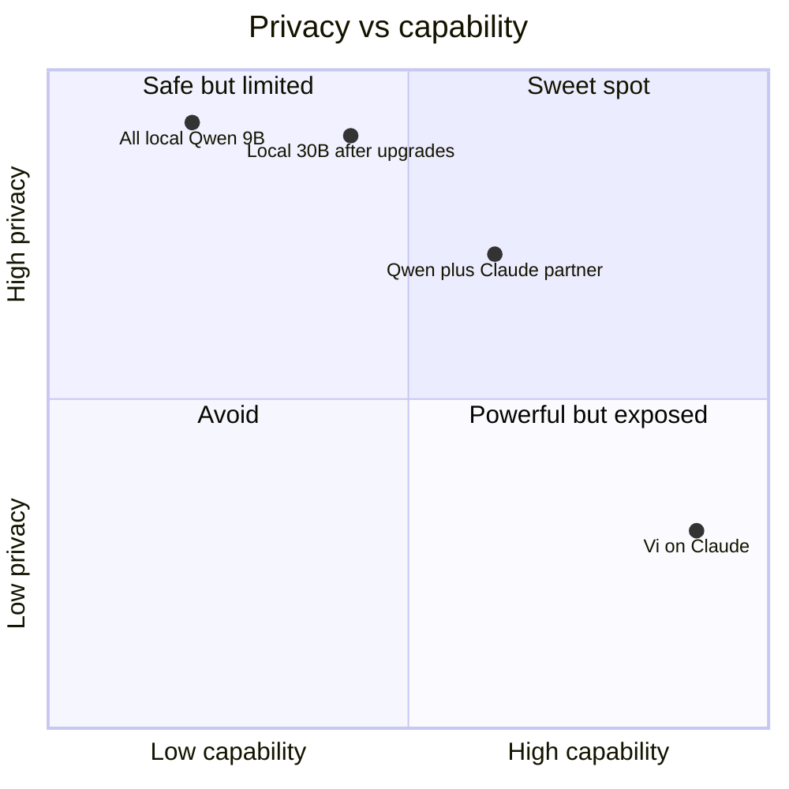

### 💡 Ideas I explored along the way

**A local "gate agent".** A small local model reads every outgoing question and flags personal details that patterns miss:

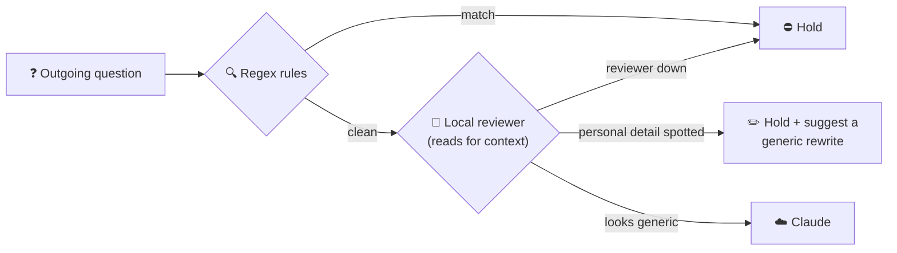

It would catch things like *"my spouse and I want to retire early, how much should we save?"* and it **fails closed**: if the reviewer is down, nothing goes out. It fits option 2 well. With option 3 it would have to screen every chat turn, and any false positive would stall the conversation.

**A smaller local model for speed.** Faster, but worse at the exact thing that failed: following multi-step instructions and knowing when to stop. Shrinking the agent's *job* helps more than shrinking its model.

**What Claude costs.** Agents are token-hungry because of those re-sent instructions:

| Model tier | Rough monthly cost at ~10 messages/day |
|---|---|
| Claude Sonnet-class | ~$20–65 |
| Claude Haiku-class | A fraction of that |
| Either, with prompt caching working | Far lower again |
| ⚠️ One runaway loop like the Qwen incident | ~$10–15 on its own |

So a **monthly spend limit** in the provider console is essential.

**A Claude subscription instead of an API key.** Hermes has an experimental official plugin that runs turns through the Claude Code CLI on a Pro or Max plan, billed against the plan's agent allowance instead of per token. Attractive if you already pay for a plan, but consumer-plan privacy settings and terms differ from the API, so read them first.

### 🔍 Privacy fine print worth knowing

- API providers generally don't train on API data by default, but they do retain requests for some period. Consumer plans often have a training opt-in setting. Check it.
- Free tiers, such as Gemini's, may use prompts to improve products. Fine only for genuinely generic questions.
- **Web search leaks too.** A search query with private details has already left your machine.

---

## 🏁 Where I landed

For this first phase, **Vi moves from Qwen to Claude.** Capability and reliability matter more right now than perfect isolation, and I can see the trade-off clearly.

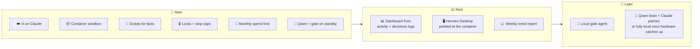

---

## 🎓 Lessons learned

1. 📦 **Containerize agents.** They run commands and write files, so give them a sandbox and only the data they need.
2. 🧮 **Scripts for facts, models for judgment.** My snapshot is a script, and it has never made up a price.
3. 🔒 **Enforce rules with permissions, not prompts.** File ownership stopped the next incident; the instructions didn't.
4. ⏱️ **Cap everything:** steps, time, requests per day, dollars per month.
5. 🔑 **Keep keys out of the agent's reach.** A separate gate container holding the keys is simple and effective.
6. 🦙 **Local-first sounds great until the model has to *do* things.** Qwen chats well; reliable multi-step tool use is where small models struggle.
7. 🧠 **Privacy is a design decision, not a filter.** Decide *which brain sees what* up front, because a cloud brain sees everything you tell it.
8. 📝 **Write down decisions.** The activity and decisions logs made the incident easy to diagnose.

---

## 🪤 Gotchas worth knowing

| Gotcha | Fix |
|---|---|
| 💥 Bind-mounting a Windows folder as Hermes' data dir crashed with "File exists" (NTFS is case-insensitive; a tool shipped files differing only in case) | Use a **named Docker volume** |
| 📏 Hermes refuses to run below 64K context | Set context length on **both** Hermes and Ollama |
| 🛡️ IMAP failed with a self-signed certificate error | Antivirus "mail shield" was intercepting TLS. Turn off mail scanning; **never** turn off certificate checks in the agent |
| 📧 Gmail app passwords missing | Turn on IMAP and 2-step verification first |
| 💬 Cron delivery to `#channel-name` failed | Target the home channel (set with `/sethome`) |
| 🔐 Files created with `docker exec` are root-owned | Set permissions on purpose, and use that to protect files agents shouldn't touch |
| ⌨️ Pasting several lines into PowerShell fed later lines into `Read-Host` prompts | Run secret-entry lines one at a time, with hidden input |
| 😮‍💨 Gemini returned "high demand, try later" on day one | Retry with backoff; it's not a broken key |
| 🗑️ `docker compose down -v` deletes volumes, and the agent's memory with them | Use `stop` / `start`, or `down` without `-v` |

---

*Built with **Hermes Agent**, **Qwen** on **Ollama**, **Claude**, Docker Desktop, Discord and a lot of PowerShell. No API keys, account details or holdings were harmed in the writing of this post.* 🦙☁️🤖
